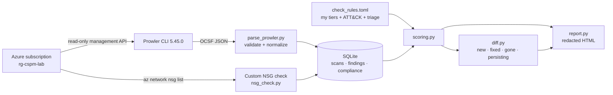
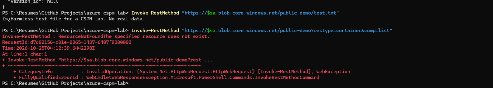
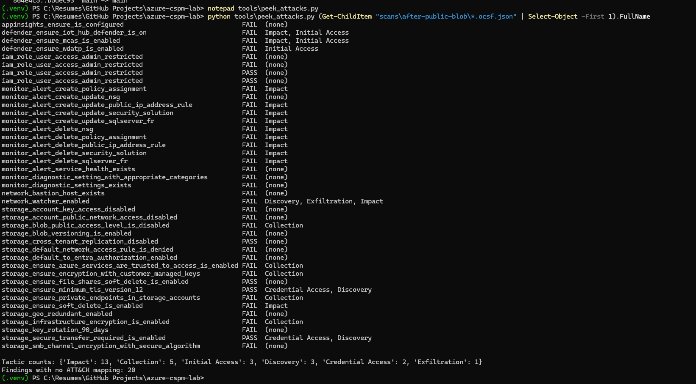
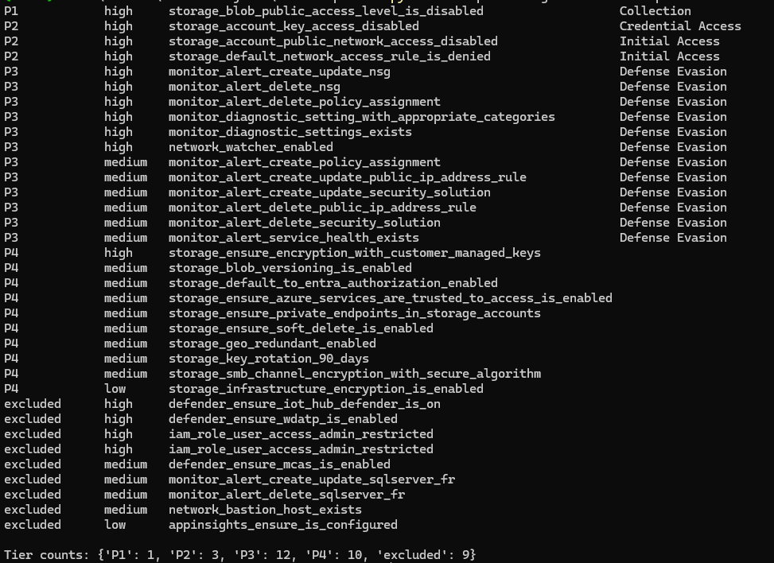
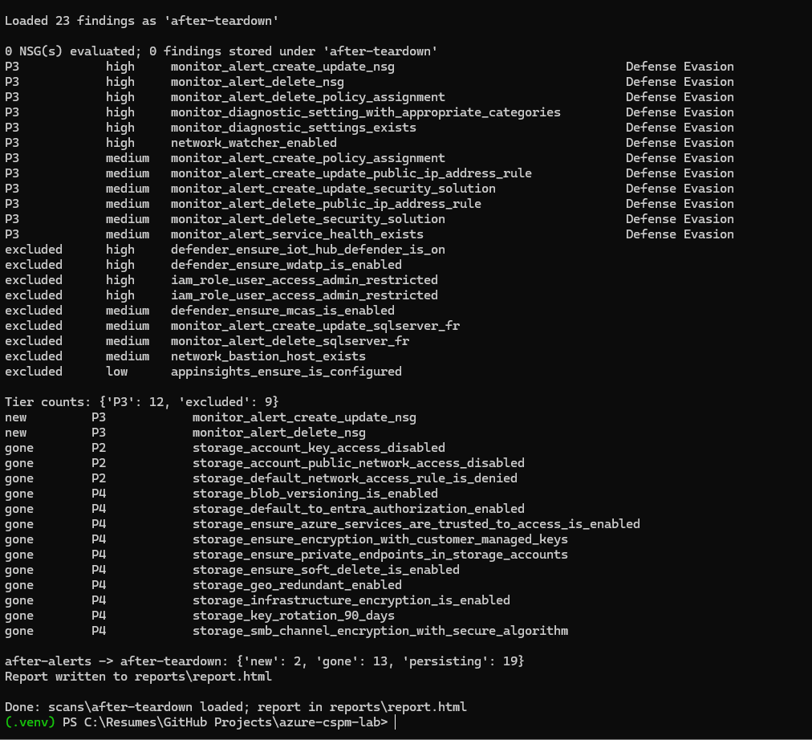
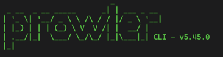

# Azure CSPM Lab

<!-- [AI-generated draft] Claude, 2026-10-25. Reviewed and edited by Daniel: [x] pending.
     All numbers below are from my real scans. Replace every TODO(Daniel) before publishing. -->

I deployed deliberately misconfigured resources in my own Azure subscription, detected them with
Prowler, and built a Python pipeline that parses the findings into SQLite, **prioritizes them by real
exposure instead of the scanner's severity labels**, tracks what changed between scans, and produces
a redacted HTML report. It's the cloud counterpart to my internal attack surface management pipeline
(Nmap/OpenVAS/Nessus → SQLite → CVSS/KEV/EPSS scoring → Jira).

Along the way I found and proved a **false negative in Prowler**: its SSH check passes NSG rules
that open SSH to the internet when the rule lists more than one port.
([write-up](docs/findings/prowler-nsg-multiport-false-negative.md))

**Want to run this lab yourself?** See the step-by-step [GETTING_STARTED](GETTING_STARTED.md). No programming experience needed.


> **Scope and authorization:** every resource was created by me, in my own Azure for Students
> subscription, for this project. Every scan was locked to that one subscription
> (`--subscription-ids`). The subscription sits in my university's Entra ID tenant, so I excluded
> tenant-wide Entra checks from every scan: the directory isn't mine to assess.

## Architecture



## What I planted, and what happened

| Pillar | Misconfiguration | Detected by | My tier | Outcome |
|---|---|---|---|---|
| Storage | Blob container readable anonymously from the internet | Prowler | **P1** | Proved with an unauthenticated request, then fixed at the account level |
| Network | NSG rule allowing SSH + RDP (22, 3389) from any source | **My custom check** (Prowler missed SSH) | P2 (unattached) | Rules removed; fixed |
| Identity | Unused managed identity with User Access Administrator on the subscription | Prowler + my scoping rule | P2 | Assignment removed before the identity, avoiding an orphaned assignment |
| Detection | No activity log alerts for NSG changes | Prowler | P3 | Alerts created and **tested by triggering them** |


*Proving the exposure, not just the setting: an unauthenticated request reads the blob, while listing the container is refused.*

### Scan history (real results)

| Scan | Findings | FAIL / PASS | What changed |
|---|---|---|---|
| baseline | 23 | 21 / 2 | Empty subscription: all subscription-level gaps |
| after-public-blob | 41 | 35 / 6 | One storage account added 14 failing checks; **1 P1** |
| after-remediation | 41 | 34 / 7 | P1 fixed |
| after-open-nsg | 45 | 34 / 11 | Open NSG rule: **Prowler's new NSG checks all passed** |
| after-nsg-experiment | 45 | 35 / 10 | Controlled experiment: single-port rule caught, multi-port missed |
| after-identity | 46 | 36 / 10 | Over-privileged identity: new P2 |
| after-fixes | 45 | 34 / 11 | NSG + identity remediated: 3 fixed, 1 gone (deleted assignment) |
| after-alerts | 45 | 32 / 13 | Two detection gaps closed |
| after-teardown | 23 | 21 / 2 | Lab deleted: 13 gone; 2 alert checks regressed (see below) |

## Prioritization: why I don't use Prowler's severity directly

In the exposed-state scan, Prowler rated **"customer-managed keys not used"** as *high*, the same
as the **anonymously readable blob**. Only one of those was real exposure. Prowler's built-in
MITRE ATT&CK tags didn't separate them either: both map to *Collection*, and 20 of 41 findings
(including the two that made the blob reachable from anywhere) had no mapping at all. The tags
are static per check; they can't know what's actually exposed in my environment.


*Prowler's built-in ATT&CK tags: the public blob and CMK both map to Collection, and many checks have no mapping.*

So I maintain my own mapping in [`config/check_rules.toml`](config/check_rules.toml), the same
approach as my ASM project, where I mapped threats to ATT&CK myself:

| Tier | Exposure class | Example |
|---|---|---|
| **P1** | Direct exposure: anonymous or internet access | public blob; NSG open to internet *and attached* |
| **P2** | Exposure enabler: makes a P1 reachable | public network access, shared keys, over-privileged identity |
| **P3** | Detection gap: an attack would go unnoticed | missing activity log alerts and diagnostic settings |
| **P4** | Hardening: defense in depth | CMK, versioning, soft delete, geo-redundancy |
| Excluded | My triage decision, with the reason kept | out of scope, accepted cost, not applicable |

Exposure enablers rank above detection gaps because ASM is about shrinking what's reachable;
logging tells you about an attack after the fact. (A detection-first team could reasonably argue
the other way.) Prowler's severity is kept as the tie-breaker within a tier. Checks without a rule
are reported as **unclassified** so new checks never slip through silently.

Result for the exposed-state scan: 35 failures → **1 P1, 3 P2, 12 P3, 10 P4, 9 excluded**.


*Same scan, my tiers: CMK keeps Prowler's "high" label but drops to P4; the public blob is the only P1.*

Exclusions can match a resource prefix, not just a check: my university's two root-scope
User Access Administrator assignments are excluded as out of scope, while the same check on a
subscription-level assignment I created is still scored P2.

## Engineering decisions worth noting

- **Verify field meanings with real data.** Every OCSF finding has `status: "New"`; pass/fail lives in `status_code`. A parser built on field names alone would have marked everything identical.
- **Facts are stored; scores are computed on read.** Changing a rule re-scores every historical scan without reloading.
- **Finding identity = check ID + resource ID**, which powers the scan diff. Two edge cases I hit and handled: "does X exist?" checks fail on the subscription but pass on the new resource (counted as *fixed*), while a deleted resource whose check passes elsewhere stays *gone*.
- **Fail loudly.** An expired Azure login once produced an empty export that looked like valid input; the custom check now stops with a clear message, and a test covers it.
- **Keep monitoring out of the workload's blast radius.** My NSG alerts watched the whole subscription, but the alert resources lived in the lab's resource group, so tearing down the lab silently deleted the monitoring. The diff caught it as a regression (2 alert checks "new" again). In production, alerting and governance belong in their own resource group.


*Teardown: 13 storage findings correctly "gone" (deleted, not fixed), and 2 alert checks flagged as new because the alert rules were deleted with the lab.*

- **Redaction with a backstop.** Prowler writes subscription IDs into finding text. The report scrubs GUIDs and emails from all text, then re-scans the finished page and refuses to write it if anything survived.
- **Parameterized SQL** everywhere, one transaction per scan, and idempotent loads.

## Tests and CI

32 pytest tests, each tied to a bug or edge case from this project (multi-port NSG rules, the
`status`/`status_code` trap, root-scope exclusions, the existence-check diff case, redaction).
I verified the key tests by reintroducing Prowler's bug into my check: they failed, then passed
once the fix was restored. GitHub Actions runs the tests plus gitleaks secret scanning on every push.

## Cost controls

Azure for Students (credit-based, no card). $5/month budget with alerts at 50%/100% actual and
80% forecast; budgets alert but don't stop spend, so the credit limit is the hard stop. Defender
paid plans confirmed off. No VMs, Bastion, or other hourly-billed resources. Everything lived in one
resource group, deleted at the end. Details: [docs/cost-controls.md](docs/cost-controls.md).


## Secret hygiene

Prowler used my existing `az login` session, so no client secret ever existed. Raw scans and the
database are gitignored (they contain account identifiers). gitleaks runs as a pre-commit hook and
in CI. Screenshots are redacted.

## Running it

Requires Python 3.12, Prowler 5.45.0 (via pipx), the Azure CLI, and `az login`.



*All scans in this project were run with Prowler CLI 5.45.0. Prowler is an open-source project by its own maintainers; this lab isn't affiliated with it.*

```powershell
.venv\Scripts\Activate.ps1
.\scripts\run_scan.ps1 -Label my-scan -Before previous-scan   # scan → load → custom check → score → diff → report
pytest -v
```

## Limitations

- One small subscription and a handful of planted issues; not a production-scale assessment.
- Entra ID checks excluded (university tenant), so identity coverage is subscription-level RBAC only.
- Prowler flags the over-privileged identity but can't tell it's *unused*; that needs sign-in or activity data.
- The custom NSG check only covers SSH/RDP and only ran on scans after it was written.
- NSG tiering doesn't evaluate rule priority (a higher-priority Deny could shadow an Allow).
- Public snapshot scenario dropped: it needs billable disks for little extra learning.
- A tag update on the NSG was denied by the subscription's region policy even though the NSG was in an allowed region; I tested the alerts with a temporary NSG instead and didn't find the cause.
- Activity log alerts are not real-time. 

## AI usage

I used Claude as a pair-programming mentor. Every AI-generated file is labeled in its header and
logged in [AI_USAGE.md](AI_USAGE.md); I ran and verified all of it.
