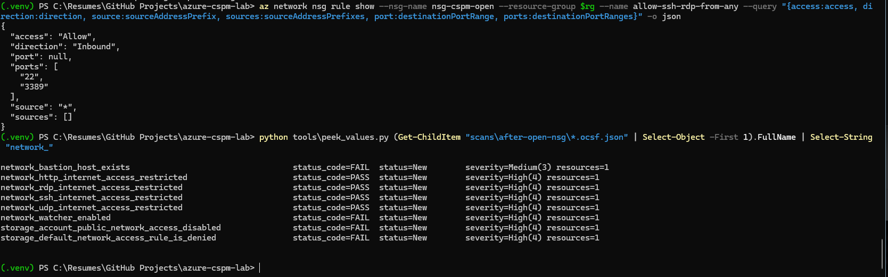
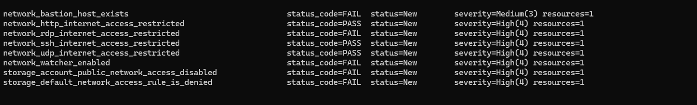
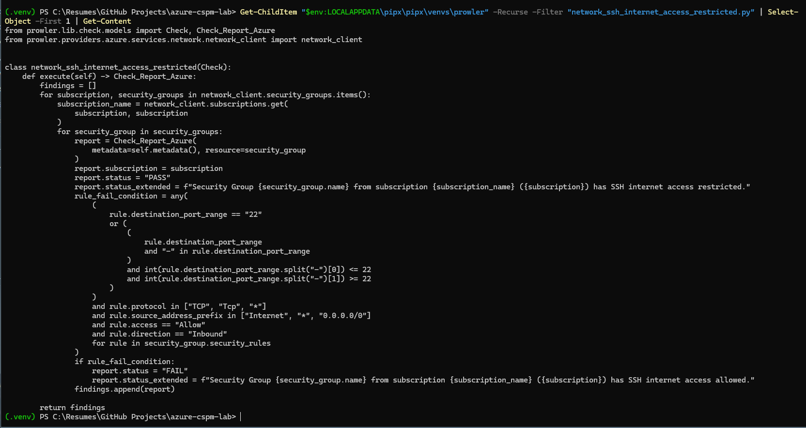
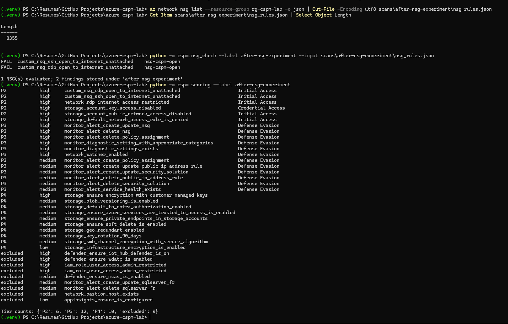

# Prowler false negative: multi-port NSG rules

<!-- [AI-generated draft] Claude, 2026-10-25. Reviewed and edited by Daniel: [ ] pending -->

**Tool:** Prowler CLI 5.45.0 · **Checks:** `network_ssh_internet_access_restricted`
(and by the same logic `network_rdp_internet_access_restricted`) · **Impact:** an NSG rule that
opens SSH to the entire internet is reported as **PASS**.

## What I saw

I created an NSG rule allowing inbound TCP from `*` to ports `22 3389`. Prowler evaluated the NSG
and **passed** both the SSH and RDP checks.

## Hypothesis

Azure stores a rule's ports in one of two fields: `destinationPortRange` (single value) or
`destinationPortRanges` (list). Confirmed with `az network nsg rule show`:

```
"port": null,
"ports": ["22", "3389"],
"source": "*"
```

If the check only reads the singular field, it sees no port at all.


*Azure stored the ports in the plural field; all of Prowler's NSG checks passed.*

## Controlled experiment

I added a second rule identical except for one variable: a single port, `3389`, which Azure stores
in the singular field. Re-scan results:

| Check | Before | After |
|---|---|---|
| network_rdp_internet_access_restricted | PASS | **FAIL** (caught the single-port rule) |
| network_ssh_internet_access_restricted | PASS | **PASS** (port 22 still only in the multi-port rule) |


*After adding a single-port rule: RDP fails, SSH still passes.*

## Root cause (source code)

The check's fail condition only compares `rule.destination_port_range` to `"22"` or a `"a-b"`
range. It never reads `destination_port_ranges`.


*The fail condition only reads destination_port_range (singular).* Reading the code also shows two likely related
gaps I did **not** test against Prowler: a destination port of `*` (all ports) doesn't match, and
only the singular `source_address_prefix` is checked.

For comparison, Steampipe/Powerpipe's control for the same CIS requirement merges the singular and
plural port and source fields and treats `*` as matching.

## What I did about it

- Wrote a compensating check (`src/cspm/nsg_check.py`) that merges both fields, treats `*` as every
  port, and records whether the NSG is attached (attached → P1, unattached → P2).


*My compensating check flags the SSH exposure Prowler passed.*

- Added tests built from the exact rule Prowler passed; verified they fail if the fix is removed.
- Chose not to report upstream for now; documented here instead.

